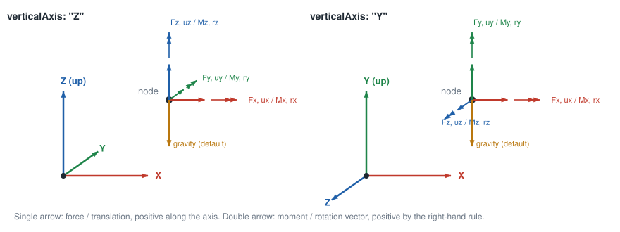
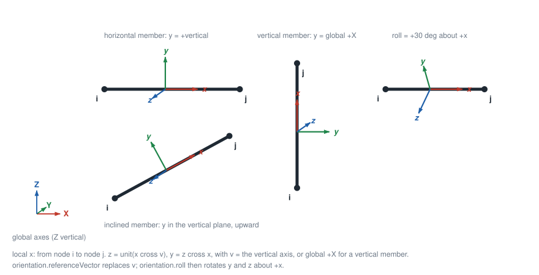
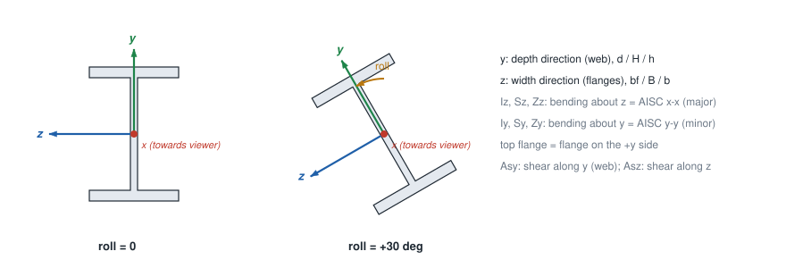
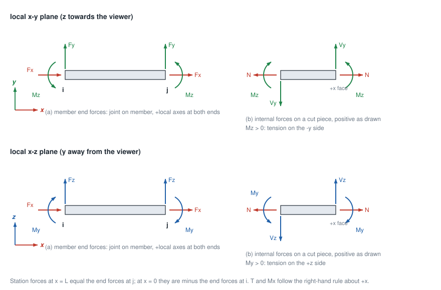

# Conventions

This is the single place where the axis and sign conventions of BenchFEA are
defined. Every input file declares them in its `conventions` block; the engine
supports exactly the values listed here and refuses a file that declares
anything else (it never silently reinterprets a model).

```jsonc
"conventions": {
  "verticalAxis": "Z",                       // "Z" or "Y"  (required)
  "handedness": "right",                     // the remaining entries are optional;
  "rotations": "right-hand-rule",            // each has a single supported value,
  "memberLocalX": "i-to-j",                  // which is also its default
  "defaultOrientation": "y-toward-vertical",
  "memberEndForces": "on-member-local",
  "internalForces": "positive-face",
  "reactions": "on-structure-global",
  "loads": "along-positive-axes"
}
```

The figures are generated by `docs/figures/make_figures.py` (the member triads
in them are computed by the engine's own `benchfea.geometry.local_triad`).

## 1. Global axes, displacements, loads, reactions



* Global axes X, Y, Z are right-handed. `verticalAxis` names the axis that
  points **up** (`"Z"` or `"Y"`). It is used for three things only: the default
  member orientation (section 2), the default direction of gravity for
  `selfWeight` loads (the negative vertical axis), and the default normal of a
  rigid diaphragm.
* Each node has six degrees of freedom in this order:
  `ux, uy, uz, rx, ry, rz` — translations along and rotations about global X,
  Y, Z. Global DOF number = `6 * (node index) + k`, nodes in file order.
* Translations and forces are positive along the positive axis. Rotations and
  moments are positive by the right-hand rule about the positive axis.
  Rotations are in radians.
* **Loads**: a nodal load `Fz: -10` acts along −Z. Member loads have a
  `direction`: `X`, `Y`, `Z` (global) or `x`, `y`, `z` (member local); a
  positive value acts along (force) or about (moment) the positive axis.
  Gravity loads on a model with Z up are therefore negative `Z` values.
* **Projected loads** (`projected: true`, global directions only): the
  intensity is per unit length of the member's projection on the plane normal
  to the load direction. The engine multiplies it by `|x_local × direction|`
  to obtain the intensity per unit length of member.
* **Positions along a member** are measured from the start of the flexible
  length (end i, after the rigid offset): fractions of the flexible length with
  `positionType: "relative"` (default), distances with `"absolute"`.
* **Reactions** are the forces and moments the supports exert **on the
  structure**, in global axes (a pinned support under a downward load has a
  positive vertical reaction). Spring supports report `-k u`.
* **Imposed support displacements** are loads (`supportDisplacement`) acting on
  DOFs that a support fixes; they follow the same sign rule as displacements.

## 2. Member local axes



A member runs from node `i` to node `j`. With rigid end offsets the *flexible
length* runs from `node i + offset i` to `node j + offset j`; local axes, loads,
stations and results all refer to the flexible length.

1. **local x** = unit vector from the flexible start to the flexible end.
2. **reference vector v** = `orientation.referenceVector` if given; otherwise
   the global vertical axis; except that for a vertical member (the sine of the
   angle between x and the vertical axis is ≤ 1e-6) v = global +X.
3. **local z** = unit(x × v), **local y** = z × x. Local y therefore lies in
   the plane of x and v, on v's side: for the default rule y points "as far up
   as possible" and z is horizontal.
4. **roll**: `orientation.roll` (degrees) then rotates y and z about +x by the
   right-hand rule: y' = y cos r + z sin r, z' = −y sin r + z cos r.

Consequences of the default rule (Z up): a beam along +X has y = +Z, z = −Y; a
beam along +Y has y = +Z, z = +X; a column (either direction) has y = +X.
A reference vector parallel to the member, or a zero vector, is refused. A
member that is almost but not exactly vertical gets a warning, because its
default y direction then depends on a tiny horizontal offset.

Rigid end offsets are vectors from the node to the flexible end, in global axes
(default) or in `"local"` axes — the latter meaning the triad obtained by
applying the rule above to the **node-to-node** line.

## 3. Cross-section axes



Section axes coincide with member local y and z. Local y is the depth
direction (the web of an I-shape; dimensions `d`, `H`, `h`), local z the width
direction (the flanges; `bf`, `B`, `b`). Hence, with the default orientation, a
beam bends about its major axis under gravity.

| engine name | meaning | AISC name for an I-shape |
|---|---|---|
| `Iz`, `Sz`, `Zz`, `rz` | bending about local z | Ix, Sx, Zx, rx (major axis) |
| `Iy`, `Sy`, `Zy`, `ry` | bending about local y | Iy, Sy, Zy, ry (minor axis) |
| `Asy` / `Asz` | shear area for shear force along y / z | — |
| `Mz`, `Vy` | major-axis moment, shear in the web | Mx, Vy |
| `My`, `Vz` | minor-axis moment, shear in the flanges | My, Vx |

**Design variables use AISC axis letters**: `Lx`, `Kx`, `Cmx`, `bracing.major`
refer to the AISC x-x (major) axis, i.e. bending about **local z**; `Ly`, `Ky`,
`Cmy`, `bracing.minor` refer to the AISC y-y (minor) axis, i.e. bending about
**local y**; `Lz`, `Kz`, `bracing.torsion` refer to twist about the member axis.
The mapping is fixed (it does not depend on which inertia is larger). The "top
flange" is the flange on the +y side.

## 4. Member end forces and internal forces



**Member end forces** (`endForces`, 12 numbers: `Fx, Fy, Fz, Mx, My, Mz` at end
i, then at end j) are the forces and moments the joints exert **on the member**
at the two ends of its flexible length, as components along the member local
axes. The same positive directions (+x, +y, +z) apply at both ends.

**Internal forces** at a station (`N, Vy, Vz, T, My, Mz`) are the stress
resultants acting on the cross-section face whose outward normal is +x (the
face seen from end j), as components along the local axes:

| quantity | definition | positive means |
|---|---|---|
| `N` | force along +x on the +x face | tension |
| `Vy`, `Vz` | force along +y, +z on the +x face | — |
| `T` | moment about +x on the +x face | right-hand rule about +x |
| `Mz` | moment about +z on the +x face, Mz = −∫ y σ dA | tension on the −y side ("sagging" when y is up) |
| `My` | moment about +y on the +x face, My = +∫ z σ dA | tension on the +z side ("hogging" when z is up) |

Relations that follow (w = distributed load per unit length in local axes, v
and w the deflections along y and z):

* at x = L: station forces = end forces at j; at x = 0: station forces =
  −(end forces at i);
* dN/dx = −w_x, dVy/dx = −w_y, dVz/dx = −w_z;
* dMz/dx = −Vy, dMy/dx = +Vz;
* Mz = E Iz v″, My = −E Iy w″ (Euler–Bernoulli part);
* normal stress σ = N/A − Mz y / Iz + My z / Iy.

Example: a simply supported beam of span L with y up and a uniform load
w_y = −q has end forces Fy = +qL/2 at both ends, Vy(x) = −qL/2 + q x and
Mz(x) = q x (L − x) / 2 ≥ 0.

Station displacements are the total displacements of the member axis in local
axes (`ux, uy, uz`), rigid-body motion included; deflection checks measure them
relative to the chord through the design member's ends.

## 5. Releases, supports, constraints

* **Releases** are given per member end and per local DOF (`ux … rz`):
  `false` rigid, `true` fully released, `{"spring": k}` partial (a spring of
  stiffness k between the member end and the node, or the end of the rigid
  offset). Combinations that leave the member free to move as a rigid body are
  refused.
* **Supports**: per global DOF `"fixed"`, `"free"` or `{"spring": k}`.
  Shorthands: `fixed` = six DOFs; `pinned` = three translations; `roller` =
  the translation along the vertical axis only. Entries in `dofs` override the
  shorthand.
* **Rigid link**: u_s = u_m + θ_m × (x_s − x_m), θ_s = θ_m (all six DOFs of the
  slave). **Rigid diaphragm** with normal n: the two translations in the plane
  and the rotation about n follow the master by the same relation, using only
  the in-plane part of (x_s − x_m); the other three DOFs of the slave stay
  independent. These are exact linear (small-displacement) kinematic
  constraints, not penalty springs.

## 6. Units

The file declares `units: {force, length}` with force ∈ {N, kN, lbf, kip} and
length ∈ {mm, m, in, ft}. Every dimensional number is in the consistent unit
built from the two (kip and in: stress in kip/in², moment in kip·in, unit
weight in kip/in³). Rotations are radians; `roll` is degrees. The engine
converts to N and mm with exact factors (1 in = 25.4 mm, 1 ft = 304.8 mm,
1 lbf = 4.4482216152605 N — NIST SP 811, Appendix B.8) and reports results in
the file's units. The dimension of every field is the `x-unit` annotation in
the JSON Schema.
